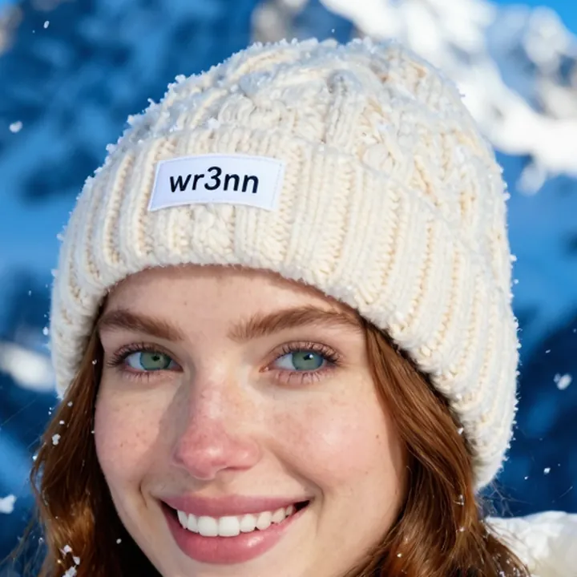
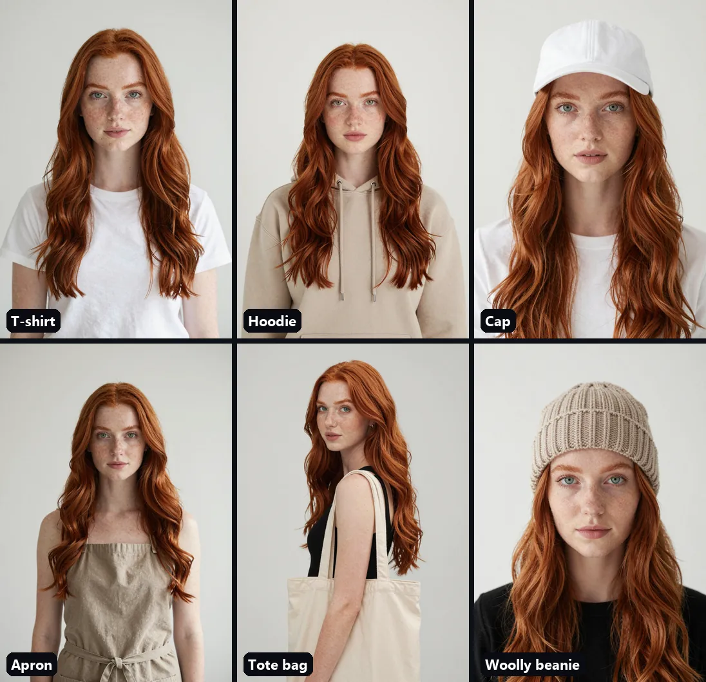
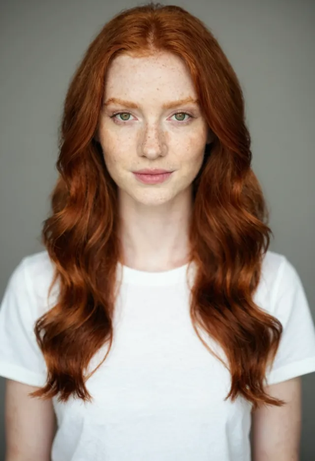

# Why your LoRA's trigger word prints on clothes

*Bravikron Labs · Free guide · Published 16 November 2026*

We trained a character LoRA on Z-Image, and its made-up trigger word started showing up as a label on her clothes. Here's why it happens, how to test any LoRA for it, and what fixed it for us.

Based on our own tests with Wren and Mika Vale on Z-Image. Web version: <https://bravikron.com/trigger-word-text-on-clothes.html>

## 01 · The problem: "wr3nn" on a woolly hat

Our free photoreal character Wren started life as a Z-Image LoRA with the trigger word `wr3nn`. We picked it the usual way: a rare, l33t-style word so it doesn't clash with anything the model already knows.

The character came out well, but the test images had a surprise. "wr3nn" appeared on a woolly hat, on a hoodie patch and on other clothes. In the image below it's printed on a neat little label, as if it were the brand.



*Before: Wren v1.0, trigger `wr3nn`. The trigger word is printed on the beanie.*

It makes sense once you see it. Z-Image is good at drawing text. A made-up word that looks like a name or a label can get drawn as one, and clothing gives it plenty of places to land: labels, patches, chest prints and hat cuffs.

## 02 · How to test: test any LoRA for it in four steps

The problem doesn't show up in every image, so a few nice showcase renders won't tell you much. Here's the checklist we now run on every character LoRA:

1. **Give the text somewhere to land.** Use prompts with a blank surface, such as a plain white t-shirt, a woolly hat or a hoodie.
2. **Render several seeds.** One clean image proves nothing. We use three seeds per prompt.
3. **Check every saved checkpoint,** not just the final one. Earlier checkpoints of our Mika Vale LoRA printed her tattoo onto clothes in places.
4. **Zoom in.** Small labels and patches are easy to miss at thumbnail size.

Our test set is six plain garments: a t-shirt, a hoodie, a cap, an apron, a tote bag and a woolly beanie. Each one is a big, empty surface the model might want to decorate.



*Our six test garments with Wren v1.1 (same seed, final checkpoint). None of them shows the trigger word.*

## 03 · What we changed: a plain full name as the trigger

On our next Z-Image character, [Mika Vale](https://civitai.com/models/3045287), we used a plain full name as the trigger instead of an l33t-style word. In 24 test images across 4 checkpoints, nothing printed on the clothes.

So for [Wren v1.1](https://civitai.com/models/3038306) we retrained with the trigger `Wren Ashby` and ran the same kind of tests:

- **117** test images over 3 checkpoints, including all 6 garments: no visible letters at normal size, and no "wr3nn"-style label
- **24** t-shirts and beanies zoomed in, cuffs included, across Base and Turbo: no text at all
- **48** images in our second round, comparing Base with three Turbo strengths

One honest detail: zooming in on some of the first 117, we found tiny garbled print near the bottom hem of two tote bags. It wasn't the trigger word, but if your prompts include bags, adding "no text, no logo" is a good idea.

| After: plain white t-shirt | After: plain woolly beanie |
|---|---|
|  |  |

> **Not proof.** That's two characters on one base model. A plain name worked for us, and it costs nothing to try, but test your own LoRA anyway.

## 04 · A side effect: Turbo turned the trigger into a man

A plain name fixed the text, but it brought a new surprise. On Z-Image Turbo, a prompt with only the trigger and no other description of the person gave us a young red-haired man in 9 of 9 images. On Z-Image Base, the same prompt gave Wren every time.

Adding "a woman" fixed the gender, but on its own it didn't keep her look: the hair drifted to brown and the eyes to blue-grey. Here's what worked:

- **Put "a woman" right after the trigger**, especially on Turbo.
- **Best results: Z-Image Base**, 28 steps, CFG 4, LoRA strength 1.0.
- **Fast option: Z-Image Turbo**, 8 steps, CFG 1, LoRA strength 1.8–2.0.
- **Keep hair and eye colour in the prompt** for hat and beanie scenes, or the hair can go brown under the hat.

```
Wren Ashby, a woman, copper-red wavy hair, green eyes, wearing a plain woolly beanie on a snowy mountain
```

## 05 · Already have the problem? If your LoRA prints its trigger

You don't have to retrain straight away. Two things to try first:

- **Negative prompt:** add `text, letters, logo` on models that use a negative prompt.
- **Reword the clothing:** ask for something that clearly has no print, such as "unbranded plain hoodie" instead of "hoodie".

If it keeps happening, retraining with a plain full name as the trigger is what fixed it for us.

## Quick checklist

- Test with blank surfaces: t-shirt, hoodie, cap, apron, tote bag, woolly beanie.
- Render several seeds per prompt.
- Check every saved checkpoint, not just the last.
- Zoom in on labels, patches, cuffs and hems.
- Prefer a plain full name over an l33t-style trigger on Z-Image.
- With a name trigger, add "a woman" (or "a man") and the key colours to your prompts.

---

We test every custom LoRA this way: <https://bravikron.com/labs.html>. Try [Wren](https://civitai.com/models/3038306) and [Mika Vale](https://civitai.com/models/3045287) for free on Civitai. This guide grew out of our [article on Civitai](https://civitai.com/articles/38216/why-your-loras-trigger-word-prints-on-clothes-and-how-to-test-for-it).
